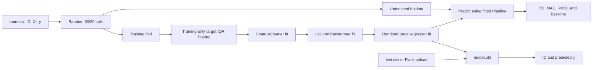

# Technical Deep Dive — Mercedes-Benz Greener Manufacturing

> **Goal:** Build a reproducible machine-learning research workflow for predicting manufacturing test time, while keeping training-time preprocessing, evaluation and CSV inference consistent. This is a software and modeling study, not a verified factory deployment.

[← README](README.md) · [EDA notebook](notebook/eda.ipynb)

## 1. Scientific framing and dataset

The [Kaggle Mercedes-Benz Greener Manufacturing competition](https://www.kaggle.com/competitions/mercedes-benz-greener-manufacturing) supplies supervised training rows with anonymized predictors and a continuous target `y` denoting test time. Evaluation rows have the same predictor schema, but no target. That separation is central: unlabeled competition rows cannot provide evidence of predictive accuracy.

The original repository investigated categorical encoding, low-information binary features, target outliers and several regression algorithms. In the active training code, Random Forest with 256 trees was chosen. The revised implementation retains that choice but provides a transparent, correct held-out evaluation before saving a model for inference.

## 2. What was broken in the original integration?

| Prior behavior | Consequence | Revised behavior |
| --- | --- | --- |
| Empty `train_pipeline.py` | No single training entry point | `python -m src.pipeline.train_pipeline` |
| Preprocessor fitted on train + competition-test features | Transductive feature vocabulary and unclear evaluation boundary | Preprocessing fitted on labeled training **fold only** |
| Targets screened before the split | Preprocessing influenced by future validation outcomes | Split first; compute target-IQR rule only on training fold |
| Feature dropping separately in training, not inference | Uploaded raw CSV may have different columns | Save preprocessing and Random Forest in one scikit-learn `Pipeline` |
| Model selected by training R² | Training fit mistaken for generalization | Holdout R²/MAE/RMSE + mean baseline |
| Prediction CSV uploaded into Flask session by file path | Stale outputs and unsafe state handling | Random token, bounded upload, short-lived server-side result, one-time download |
| Kaggle login happens inside ingestion constructor | Cannot train from local CSV without credentials | Kaggle API is imported/authenticated only when `--download-kaggle` is requested |

The artifact format changed. **Old `artifacts/model.pkl` / `preprocessor.pkl` are not compatible with this integrated pipeline; retraining is required.**

## 3. End-to-end data flow



**Splitting before fitting matters.** Encoders, imputation values, feature-selection decisions, and target-outlier thresholds are informed only by training-fold data. Held-out rows pass through the already-fitted transformations.

## 4. Feature schema and preprocessing

The relevant implementation is [`FeatureCleaner`](src/components/data_transformation.py):

1. **Drop `ID`:** a row identifier, not a manufacturing signal.
2. **Drop `X4`:** preserves the original experiment's explicit choice to exclude this highly dominant categorical variable.
3. **Remove near-constant binary columns:** for numeric fields whose observed non-missing values are only `0`/`1`, remove those with a dominant value frequency greater than 99%. Fit this rule on the training fold only.
4. **Remember the retained columns and their order.** At inference, accept raw rows in any column order, select the fitted retained columns, and fail with a readable message if a required column is missing.
5. **Impute numeric inputs** using medians learned from the training fold.
6. **Impute categorical inputs** using modal values; apply `OneHotEncoder(handle_unknown='ignore')` for a stable output geometry, even with previously unseen categories.

The fitted transformation and regressor live inside **one pickle file**. A separate preprocessor file is not needed. The raw prediction CSV can contain `ID`, `X4`, and even extra columns; none can silently alter the model's feature selection.

The original approach concatenated train and competition test before fitting the encoder. Although the test rows are unlabeled, including them can make feature-space construction depend on competition data and does not address validation leakage. The revised fitted pipeline is a cleaner inductive experimental design.

## 5. Target-outlier handling

The original notebook applied the interquartile range (IQR) rule to the target. We retain that as a default **training-fold-only** option:

$$
\mathrm{IQR}=Q_3-Q_1
$$

$$
\text{Keep }y_i\text{ when } Q_1-1.5\,\mathrm{IQR}\leq y_i\leq Q_3+1.5\,\mathrm{IQR}.
$$

The held-out set is **never** filtered by its target, because excluding difficult holdout cases would bias the measurement. Disable the training filter with `--no-outlier-filter` to assess whether rare real-world high test times are being discarded.

## 6. Random Forest regression

A Random Forest regressor combines predictions from multiple decision trees fitted on bootstrapped subsets of the training data. Conceptually, for a new input feature vector $x$:

$$
\hat{y}(x)=\frac{1}{T}\sum_{t=1}^{T} f_t(x)
$$

Here, $T=256$ by default, mirroring the final configured model in the original repository. `random_state=42` provides repeatable split and forest randomness, and `n_jobs=-1` permits parallel tree fitting.

The original model-trainer file contained exploratory grids for Decision Trees, Gradient Boosting, Linear Regression, XGBoost, CatBoost and AdaBoost. These remain part of the project's research history, but **they are not active comparators** in the revised CLI. Adding properly cross-validated comparisons would be a subsequent experiment, not a retrospective claim.

## 7. Evaluation on unseen observations

The dataset is split **before** any fitted preprocessing. Only the training fold is used to fit feature-selection rules, imputers, encoders and the Random Forest. Evaluation metrics are computed on the untouched holdout:

**Coefficient of determination:**

$$
R^2 = 1-\frac{\sum_i(y_i-\hat{y}_i)^2}{\sum_i(y_i-\bar{y})^2}
$$

**Mean absolute error:**

$$
\mathrm{MAE}=\frac{1}{n}\sum_i |y_i-\hat{y}_i|
$$

**Root mean squared error:**

$$
\mathrm{RMSE}=\sqrt{\frac{1}{n}\sum_i(y_i-\hat{y}_i)^2}
$$

For context, `DummyRegressor(strategy='mean')` is trained on the same filtered training fold and evaluated on the same holdout rows. An $R^2$ below zero is possible: by definition it is worse than predicting the **holdout sample mean** on every holdout row. The separately reported training-mean baseline gives a deployable comparison.

Metrics are persisted in `artifacts/metrics.json` along with split counts, excluded input fields, near-constant columns, and the seed. These are created **when you actually run training against the competition files**; no Kaggle score is fabricated in this repository.

## 8. Inference behavior and artifact contract

The single trained artifact contains:

```text
sklearn Pipeline
├── preprocessor: sklearn Pipeline
│   ├── feature_cleaner: FeatureCleaner (learned required columns)
│   └── column_transformer: ColumnTransformer
│       ├── categorical: mode imputer → one-hot encoder
│       └── numeric: median imputer
└── regressor: RandomForestRegressor (256 trees by default)
```

The [`PredictPipeline`](src/pipeline/predict_pipeline.py) loads this bundle and calls `.predict()` on the **raw** input DataFrame. Therefore, the batch CLI and Flask app cannot forget a column-dropping or encoding step without causing a visible test failure.

Use the command line:

```bash
python -m src.pipeline.batch_predict --input-csv notebook/data/test.csv
```

For the competition, output headers are `ID,y`. In the Flask demonstration, the download uses `ID,Prediction` if `ID` was provided. IDs remain in the same order as input records; they are never used as model features.

**Artifact trust:** `pickle.load` can execute arbitrary code if a malicious pickle is supplied. Only load artifacts you created locally or obtained from trusted sources. Package versions and feature behavior can change; pin the working versions before relying on long-lived artifacts.

## 9. Flask CSV workflow

1. A user submits a `.csv` file (10 MB request limit).
2. The app parses the file with pandas and requires at least one row.
3. The saved pipeline validates the fitted feature contract and generates predictions.
4. The server creates a random-token temporary CSV; only the token is stored in Flask's signed cookie.
5. A result page previews up to ten predictions.
6. Download consumes and removes the temporary file. Old unused files are pruned after one hour when another upload occurs.

The app uses a random development secret key unless `FLASK_SECRET_KEY` is provided. A **stable secret should be configured for persistent hosting**. The interface is a demo: it does not implement authenticated multi-user access, durable job storage, usage rate limits, or production observability.

## 10. Validation and reproducibility

Tests in [`tests/`](tests/) use **synthetic Kaggle-shaped feature tables**, rather than distributing competition CSVs. They verify:

- Consistent feature schema regardless of input-column order.
- Near-constant binary feature removal and clean rejection of missing required features.
- Train → evaluate → save artifact → reload → inference.
- Handling of unseen categorical values.
- `ID,y` competition-prediction CSV format.
- Flask upload / preview / download / malformed-upload errors (when Flask is installed).

Run:

```bash
python -m pip install -r requirements.txt
python -m pip install pytest
python -m pytest -q
```

Cloud deployment has **not** been tested as part of this revision. The previous Azure auto-deployment workflow was replaced by a normal test workflow, so commits do not deploy an untrained app with missing model artifacts. The existing Elastic Beanstalk configuration remains historical configuration only.

## 11. Limits and next investigations

This revision solves the key **integration and evaluation design problems**, but a scientific claim about predictive accuracy requires actually running against the official competition dataset. The original shared ZIP excluded both CSVs and trained pickle files. Consequently, a saved notebook's apparent fit and the synthetic fixture tests do not establish current held-out performance.

Recommended follow-up investigations include evaluating the effect of IQR filtering, repeated cross-validation, Gradient Boosting/XGBoost comparison, feature importance, error by high-duration subgroup, model calibration and confidence intervals, and verifying deployment under realistic traffic. These are proposals, **not experiments already completed**.

## References

- [Kaggle: Mercedes-Benz Greener Manufacturing](https://www.kaggle.com/competitions/mercedes-benz-greener-manufacturing)
- [Original project exploratory notebook](notebook/eda.ipynb)
- [scikit-learn pipeline documentation](https://scikit-learn.org/stable/modules/compose.html#pipeline)

[← Back to README](README.md)
