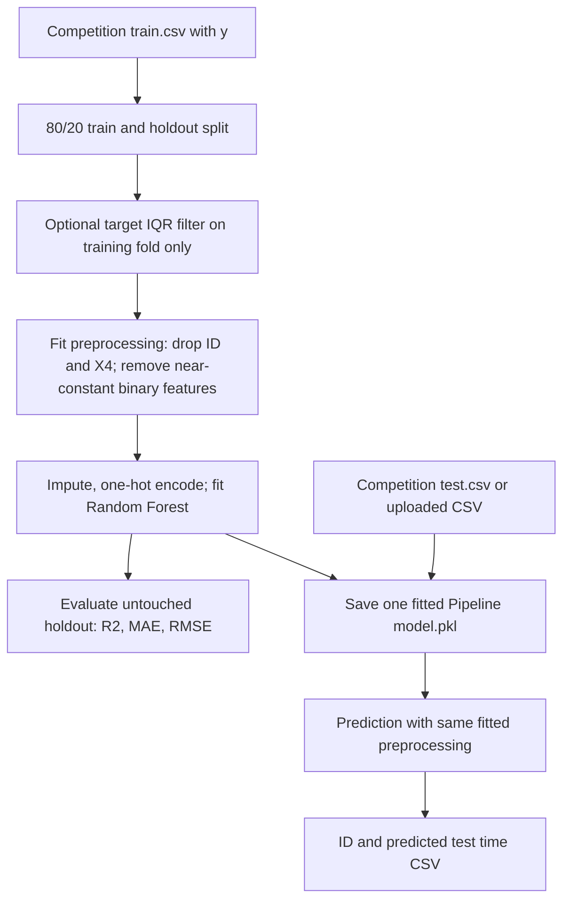

# Mercedes-Benz Greener Manufacturing

**A reproducible regression study of manufacturing test time**, with a single fitted preprocessing-and-model pipeline, held-out evaluation, Kaggle-style CSV prediction, and a lightweight Flask demonstration.

> **Scope:** This is a research / portfolio implementation based on the [Mercedes-Benz Greener Manufacturing Kaggle competition](https://www.kaggle.com/competitions/mercedes-benz-greener-manufacturing). It predicts the continuous target `y` (manufacturing test time) from anonymized feature columns. This repository does **not** claim verified production deployment or an independently measured competition score.

[**Technical deep dive →**](DEEPDIVE.md) · [**Original EDA notebook →**](notebook/eda.ipynb)

## Why this problem?

Manufacturing efficiency depends on reducing test time without sacrificing quality. In this competition, the challenge is to understand whether anonymized categorical and binary process variables can predict the time required for testing. The engineering questions are practical: How should heterogeneous features be encoded? Can an estimator generalize to unseen process configurations? And how can inference use *exactly* the transformations learned during training?

This repository started as an exploratory comparison of regression models, with custom ingestion, preprocessing, model training, and a Flask CSV-upload prototype. The revised implementation keeps those ideas while making the whole workflow runnable and separately evaluating generalization.

## System overview



**Important:** The competition `test.csv` has no `y` target. It is used for predictions, **not** for fitting encoders, selecting features, or calculating accuracy.

## What's implemented

| Component | Implementation |
| --- | --- |
| Ingestion | Local CSV files or optional authenticated Kaggle download |
| Data contract | Required feature checks, `ID` removal, original exclusion of `X4`, fit-on-training selection of near-constant binary features |
| Preprocessing | Numeric median imputation, categorical mode imputation, one-hot encoding with unknown-category handling |
| Train/validation protocol | Seeded 80/20 holdout, with target-IQR outlier filtering restricted to training rows |
| Regression | Random Forest with 256 trees by default, preserving the original project's selected approach |
| Evaluation | Holdout R², MAE, RMSE, and an always-reported mean-prediction baseline |
| Model artifact | One serialized scikit-learn `Pipeline`, with the full fitted preprocessing graph and regressor |
| Batch predictions | `ID,y` competition-style file generated from the same pipeline |
| Web interface | Flask CSV upload, preview, and one-time downloadable predictions |
| Verification | Synthetic-data tests for schema consistency, artifact round-trip, model inference, and Flask routes |

The original exploratory notebook considered Linear Regression, Decision Trees, Random Forest, Gradient Boosting, AdaBoost, XGBoost, and CatBoost. **Those alternatives are background exploration, not all models trained by the current command.**

## Quick start

Python **3.10+** is recommended. From the repository root:

```bash
python3 -m venv .venv
source .venv/bin/activate
python -m pip install --upgrade pip
python -m pip install -r requirements.txt
python -m pip install pytest
python -m pytest -q
```

### 1. Get the data

Competition CSVs are intentionally not committed. Download `train.csv` and `test.csv` from [the Kaggle competition](https://www.kaggle.com/competitions/mercedes-benz-greener-manufacturing/data), accept its terms if prompted, and place the files in:

```text
notebook/data/train.csv
notebook/data/test.csv
```

Or, with a locally authenticated Kaggle API client, let the training command fetch the files via `--download-kaggle` (requires permission to access the competition).

### 2. Train, evaluate, and export predictions

```bash
python -m src.pipeline.train_pipeline \
  --train-csv notebook/data/train.csv \
  --test-csv notebook/data/test.csv
```

Optional authenticated download:

```bash
python -m src.pipeline.train_pipeline --download-kaggle
```

A faster local smoke run can use `--n-estimators 32`. The default is 256 trees, matching the original chosen Random Forest setting. No dataset-specific holdout score is claimed here because the source ZIP excluded the CSVs and trained artifacts; **run the command on your Kaggle data and inspect the generated `artifacts/metrics.json`**.

Generated files (ignored by Git):

```text
artifacts/
├── model.pkl                     # Fitted feature transformations + regressor
├── metrics.json                  # Held-out R², MAE, RMSE, counts and baseline
├── holdout_predictions.csv       # Held-out actual y and predicted y
└── competition_predictions.csv   # Test IDs and predicted y (if test CSV provided)
```

### 3. Predict with the command line

```bash
python -m src.pipeline.batch_predict \
  --input-csv notebook/data/test.csv \
  --output-csv artifacts/competition_predictions.csv
```

Inputs may contain `ID` and `X4`, as Kaggle's raw files do. The fitted pipeline handles excluding them, selecting retained features, and encoding known/unknown categories. It rejects files missing required retained features rather than silently changing the schema.

### 4. Run the Flask CSV-upload demo

```bash
python application.py
```

Open **http://127.0.0.1:5000**, upload the competition-format test CSV, preview predictions, and download the results. Train first: the app intentionally does not load nonexistent artifacts. The default upload limit is 10 MB. To keep browser sessions stable in a deployed instance, configure `FLASK_SECRET_KEY` in your environment. The app is a demonstration, not a hardened multi-user deployment.

## Repository layout

```text
.
├── application.py                   # Flask upload / preview / download
├── src/
│   ├── components/
│   │   ├── data_ingestion.py        # Optional Kaggle API download
│   │   ├── data_transformation.py   # Train-fitted preprocessing / schema
│   │   └── model_trainer.py         # Holdout evaluation and artifact creation
│   └── pipeline/
│       ├── train_pipeline.py        # python -m entry point
│       ├── predict_pipeline.py      # Shared model inference
│       └── batch_predict.py        # CSV-to-CSV CLI
├── templates/                       # Flask interface
├── tests/                           # Data-free regression + web tests
├── notebook/eda.ipynb               # Original exploratory analysis
├── DEEPDIVE.md                      # Design and methodology
└── requirements*.txt
```

## Results and interpretation

Unlike the earlier implementation, this version does **not** use training-set R² as its selection or validation score. It evaluates on an untouched holdout split and reports a naive mean-prediction baseline for context. Accuracy values are written to `artifacts/metrics.json` each time training runs.

Because this repository does not contain the Kaggle CSVs or previously saved model pickle files, **the final numerical result on the original dataset has not been re-measured in the prepared version**. The tests use synthetic fixtures and establish pipeline correctness—not model performance on the competition data.

## Limitations and research context

- This is a single train/holdout split, not repeated cross-validation or a Kaggle leaderboard comparison.
- The target-IQR rule is a modeling choice applied only to training rows. Removing unusual but valid manufacturing cases may bias fit; compare with `--no-outlier-filter`.
- The default model remains Random Forest, selected during earlier exploration. Other regressors have not been retuned under the revised validation protocol.
- Input features are anonymized, limiting causal interpretation.
- Existing deployment configuration was not validated here; cloud services also need securely provisioned model artifacts and credentials.
- Pickle artifacts should only be loaded from trusted sources. Their Python/scikit-learn environment should match the environment that trained them.

The [technical deep dive](DEEPDIVE.md) documents the original architecture's gaps, the revised data-flow contract, the evaluation method, and future experiments.

## Credits and source

This implementation builds on the publicly available [Mercedes-Benz Greener Manufacturing competition](https://www.kaggle.com/competitions/mercedes-benz-greener-manufacturing) and the original exploratory notebook in this repository. Original project work by Aswith Sama. Competition data is not redistributed here.
